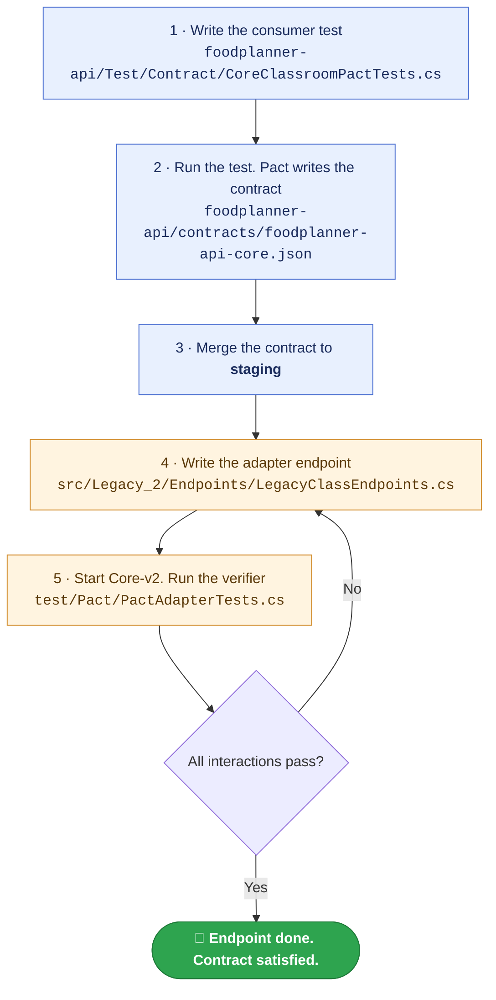

## Guide
First, ensure that Docker is running on your machine.

Then ensure you have a `.env` file in the project's root folder with the following variables set:
```
JWT_SECRET=<INSERT_SUPER_SECRET_KEY_HERE>
JWT_MAX_AGE_MS=3600000 # 1 Hour
JWT_AUDIENCES=giraf-foodplanner,giraf-weekplanner,giraf-vta
JWT_ISSUER=giraf-core
```

For development purposes, any random 256bit string will work as the `JWT_SECRET`.

You can generate one here: [Secret Generator](https://jwtsecretkeygenerator.com/)

Now run
`docker compose up --build`

Then check the following endpoint:
`localhost:8080/health`

To access the docker database, run:
`docker exec -it [container-name] psql -U [pg-user] -d [pg-db]`

For example:
`docker exec -it db_dev psql -U postgres -d defaultdb`

Now you can run SQL queries.

### Linux

For above guide on Linux run the following commands before `docker compose up --build`, to ensure a valid build platform is available.

`sudo docker buildx build .`

Might require the following package a separate 'docker buildx' package depending on your distro:
`sudo pacman -S docker-buildx`

## Migrations & New Database Tables

### Once, if dotnet-ef isn't installed

`dotnet tool install --global dotnet-ef --version 10.0.12`

### After adding your model and DbSet

`dotnet ef migrations add MIGRATION_NAME`

### Build and run; startup applies the migration

`docker compose up --build`

### Optional: discard the local database volume to fix the existing EnsureCreated/migration mismatch

### WARNING: deletes database data

`docker compose down -v`
`docker compose up --build`

## Run Tests

Run: `docker compose --profile test build --no-cache test; docker compose --profile test run --rm test`
The test seed will then be visible in the error message if a test fails.

### Pact test

The Pact test verifies core against foodplanner-api's contract. It only runs locally and is excluded from CI. Start core first using the docker command, else it fails - the docker command is essential since it ensures the dev DB is properly seeded:

```bash
docker compose up -d --build server
dotnet test test/giraf-core-v2.Tests.csproj --filter "FullyQualifiedName~PactAdapterTests"
```

### Writing an adapter endpoint
It is recommended to write adapter endpoints using Test-Driven-Development. Adapter endpoints use consumer-driven-contract testing, and means 
that it needs a contract from the consumer which defines the structure the Core adapter endpoint has to match. 

When having defined the consumer-side, it has to be pushed to their equivalent of a main branch, since the URI for the contracts looks at a hardcoded path in their staging branch. During development, you can change the URI to point at the relevant development branch on the consumer side, so you do not have to wait for it to be merged.
There is no test needed on core-v2's side, since the verifier runs every interaction in the contract, which directly calls the Core-v2 adapter endpoint - so the only changes necessary in Core-v2 is the actual adapter endpoint. 
<details>
<summary><b>Pact workflow - expand for a visual. Foodplanner is used as an example, but the flow is the same for each app</b></summary>



</details>

## Contributing

Before creating a pull request, please run `dotnet format`. This ensures consistent formatting between developers and reduces conflicts when merging.

When coding ensure that `README.Naming.md` is followed
